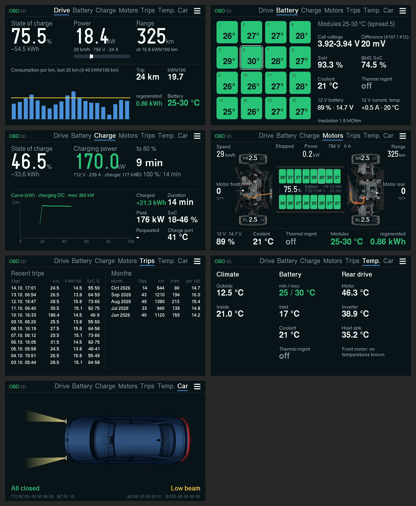
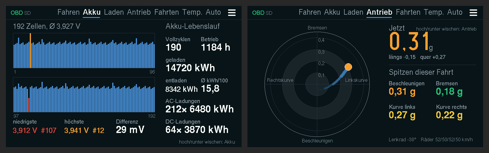

# Ioniq 6 Display (ESP32)

*[Deutsch](README.md) · English*

Read battery and driving data from a Hyundai Ioniq 6 through a Bluetooth OBD adapter (ELM327 with BLE, tested with the Vgate iCar 2) and show it in the car: on a **Waveshare ESP32-S3-Touch-LCD-4.3** (4.3", 800×480) in a 3D-printed enclosure with a battery and a stand for the tray in front of the cup holders.

Hobby project with no commercial intent, not affiliated with Hyundai. Use at your own risk; the adapter only reads, it writes nothing to the car.

Status 31 Oct 2026: firmware 86. Logs stay on the SD card, nothing is uploaded. The display speaks German and English (menu → "Sprache / Language").

Hidden by swiping up/down: cells under Battery, g-force under Drivetrain.

*Images rendered on a PC from the real display code (`esp32/test_host/sim/render.sh`), not photographed from the board.*

## Quick start

1. Get the parts: Waveshare ESP32-S3-Touch-LCD-4.3 (the "B" variant is not needed), a microSD card (FAT32), a BLE OBD adapter.
2. Flash once over USB: `esp32/firmware/ws43/ioniq6_display_merged.bin` at address 0x0 (instructions in [esp32/README.en.md](esp32/README.en.md#flashing-over-usb-windows)).
3. Press the display for 3 s, join the Wi-Fi "Ioniq6-Display" (password `ioniq6obd`) with your phone, open `192.168.4.1` and enter your home Wi-Fi. From then on the display fetches new firmware from this repo by itself.
4. Plug the adapter into the OBD port and switch the car to READY: the display finds the adapter by itself.

## Parts

| Part | Where | Summary |
|---|---|---|
| Firmware | [`esp32/`](esp32/README.en.md) | Seven pages plus two hidden ones, trip log, logs on SD card, online update, settings page over Wi-Fi, German/English |
| Enclosure | [`esp32/enclosure/ws43/`](esp32/enclosure/ws43/README.en.md) | Tray with battery compartment, 35° stand as a clamp insert for the tray, STL and OpenSCAD |
| Web app "Ioniq 6" | [Darshumar/ioniq6-logger](https://github.com/Darshumar/ioniq6-logger) | Live values and CSV recording in the browser (Chrome/Edge), charts for logs |

## In the car

Plug the adapter into the OBD port and switch the car to READY (otherwise most control units don't answer). The adapter allows only **one** connection: the ESP32, the web app and apps like Car Scanner exclude each other.

## Data sources

| Control unit | Request | Content |
|---|---|---|
| BMS 7E4 | 220101, 220105, 220106 | State of charge, voltage, current, 16 module temperatures, cell min/max, remaining energy, SoH, coolant, coolant pump, motor speeds, counters |
| BMS 7E4 | 220102/03/04/0A/0B/0C | 192 cell voltages |
| BMS 7E4 | 220111 | Number and energy of AC and DC charging sessions |
| Instrument cluster 7C6 | 22B002 | Odometer |
| Body 7A0 | 22C00B | Tyre pressure and temperature |
| Vehicle control unit 7E2 | 22E004 | Speed, accelerator pedal |
| Rear inverter 7E3 | 22E001 | Motor, inverter and heatsink temperature, speed, torque |
| ICCU 7E5 | 22E011, 22E002 | 12 V battery (state of charge, voltage, current, temperature) and DC/DC converter; on-board charger during AC charging |
| Climate 7B3 | 220100 | Outside and cabin temperature |
| Charging control 744 | 22E001–E004 | **Ready** (main relay, E004 byte 4 bit 2), charging station, charging port, requested power |

Many mappings come from [OBDb/Hyundai-IONIQ-6](https://github.com/OBDb/Hyundai-IONIQ-6) (CC BY-SA 4.0) and were checked against our own logs.
