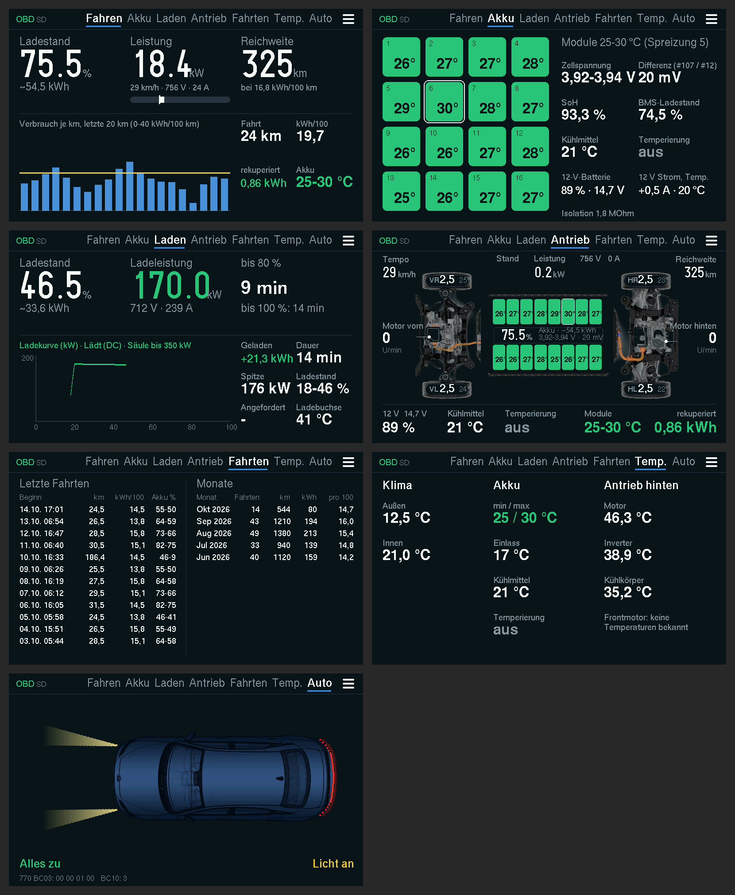
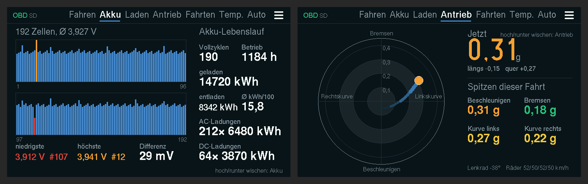

# Ioniq 6 Anzeige (ESP32)

*Deutsch · [English](README.en.md)*

Akku- und Fahrdaten des Hyundai Ioniq 6 über einen Bluetooth-OBD-Adapter (ELM327 mit BLE, getestet mit dem Vgate iCar 2) auslesen und im Auto anzeigen: auf einem **Waveshare ESP32-S3-Touch-LCD-4.3** (4,3", 800×480) in einem 3D-gedruckten Gehäuse mit Akku und Ständer für die Ablage vor den Getränkehaltern.

Hobbyprojekt ohne kommerzielle Absicht, nicht von Hyundai. Benutzung auf eigene Gefahr; der Adapter liest nur, er schreibt nichts ins Auto.

Stand 31.10.2026: Firmware 86. Logs bleiben auf der SD-Karte, es wird nichts hochgeladen.

Versteckt per Hoch-/Runterwischen: Zellen unter Akku, G-Kraft unter Antrieb.

*Bilder aus dem echten Display-Code am PC gerendert (`esp32/test_host/sim/render.sh`), nicht vom Board fotografiert.*

## Schnellstart

1. Board besorgen: Waveshare ESP32-S3-Touch-LCD-4.3 (die Variante „B“ ist nicht nötig), microSD-Karte (FAT32), BLE-OBD-Adapter.
2. Einmal per Kabel flashen: `esp32/firmware/ws43/ioniq6_display_merged.bin` an Adresse 0x0 (Anleitung in [esp32/README.md](esp32/README.md#flashen-per-kabel-windows)).
3. Am Display 3 s drücken, mit dem Handy ins WLAN „Ioniq6-Display“ (Passwort `ioniq6obd`), `192.168.4.1` öffnen und das Heim-WLAN eintragen. Danach holt sich die Anzeige neue Firmware aus diesem Repo selbst.
4. Adapter in die OBD-Buchse, Auto auf READY: die Anzeige findet den Adapter selbst.

## Teile

| Teil | Wo | Kurz |
|---|---|---|
| Firmware | [`esp32/`](esp32/README.md) | Sieben Seiten plus zwei versteckte, Fahrtenbuch, Logs auf SD-Karte, Online-Update, Einstellungsseite per WLAN, Deutsch/Englisch |
| Gehäuse | [`esp32/enclosure/ws43/`](esp32/enclosure/ws43/README.md) | Wanne mit Akkufach, Ständer 35° als Klemm-Einsatz für die Ablage, STL und OpenSCAD |
| Web-App „Ioniq 6“ | [Darshumar/ioniq6-logger](https://github.com/Darshumar/ioniq6-logger) | Live-Werte und CSV-Aufzeichnung im Browser (Chrome/Edge), Diagramme für Logs |

## Im Auto

Adapter in die OBD-Buchse, Auto auf READY (sonst antworten die meisten Steuergeräte nicht). Der Adapter erlaubt nur **eine** Verbindung: ESP32, Web-App und Apps wie Car Scanner schließen sich gegenseitig aus.

## Datenquellen

| Steuergerät | Abfrage | Inhalt |
|---|---|---|
| BMS 7E4 | 220101, 220105, 220106 | Ladestand, Spannung, Strom, 16 Modultemperaturen, Zellen min/max, Restenergie, SoH, Kühlmittel, Kühlmittelpumpe, Motordrehzahlen, Zähler |
| BMS 7E4 | 220102/03/04/0A/0B/0C | 192 Zellspannungen |
| BMS 7E4 | 220111 | Zahl und Energie der AC- und DC-Ladungen |
| Kombiinstrument 7C6 | 22B002 | km-Stand |
| Karosserie 7A0 | 22C00B | Reifendruck und -temperatur |
| Fahrzeugrechner 7E2 | 22E004 | Tempo, Fahrpedal |
| Heck-Inverter 7E3 | 22E001 | Motor-, Inverter- und Kühlkörpertemperatur, Drehzahl, Drehmoment |
| ICCU 7E5 | 22E011, 22E002 | 12-V-Batterie (Ladestand, Spannung, Strom, Temperatur) und Wandler; Bordlader beim AC-Laden |
| Klima 7B3 | 220100 | Außen- und Innentemperatur |
| Ladesteuerung 744 | 22E001–E004 | **Ready** (Hauptrelais, E004 Byte 4 Bit 2), Säule, Ladebuchse, angeforderte Leistung |

Viele Belegungen stammen aus [OBDb/Hyundai-IONIQ-6](https://github.com/OBDb/Hyundai-IONIQ-6) (CC BY-SA 4.0) und sind mit den eigenen Logs abgeglichen.
