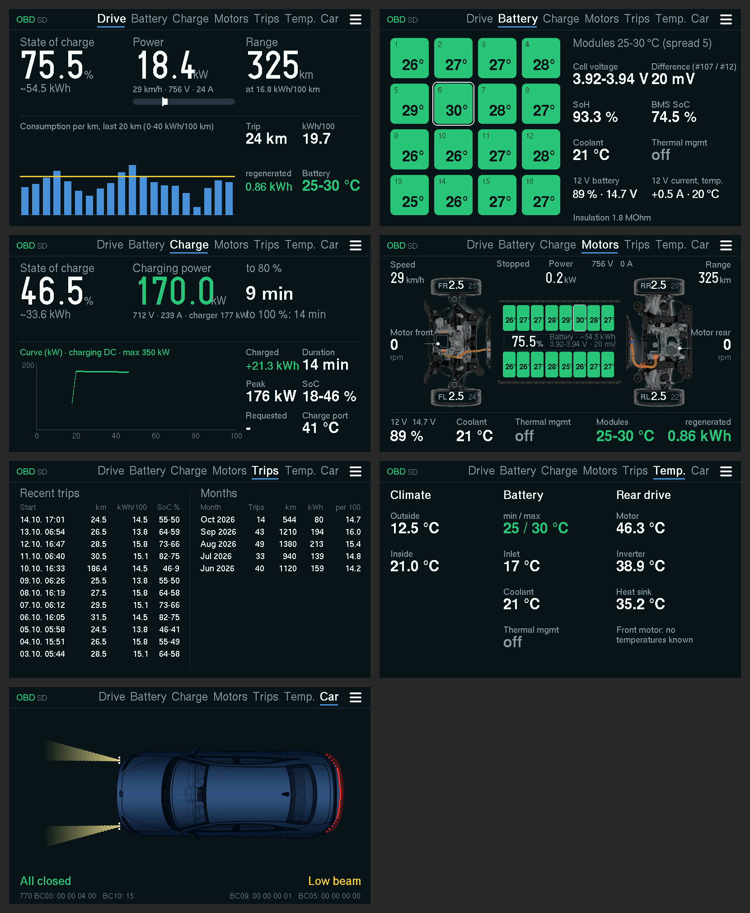
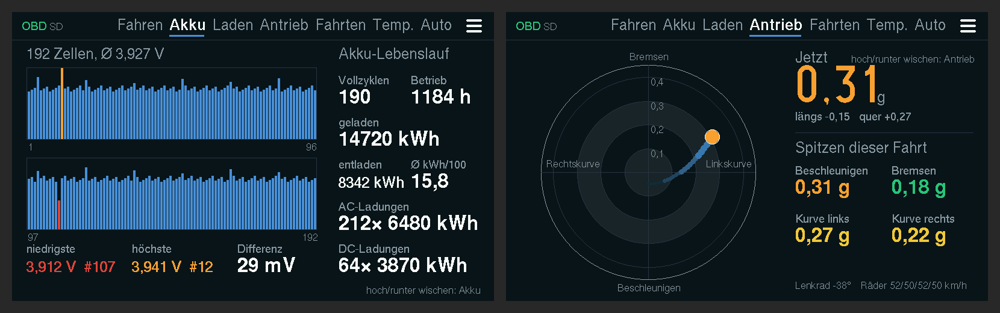
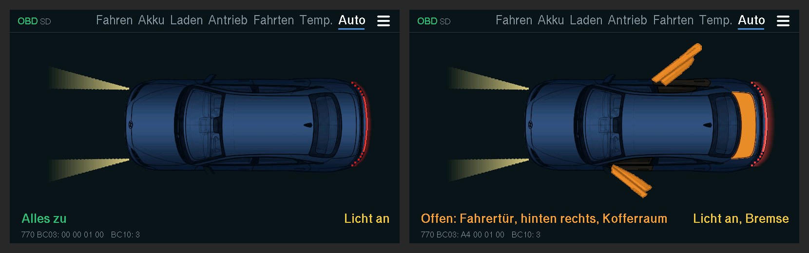
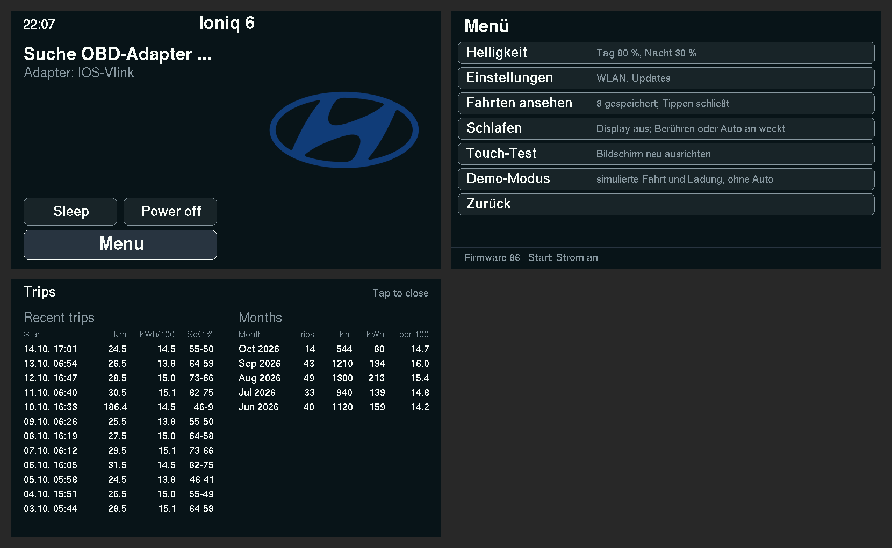
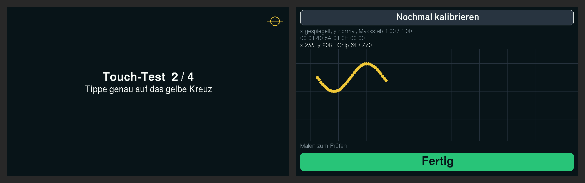
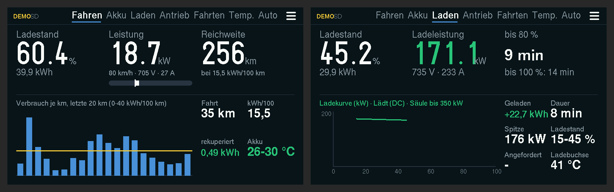
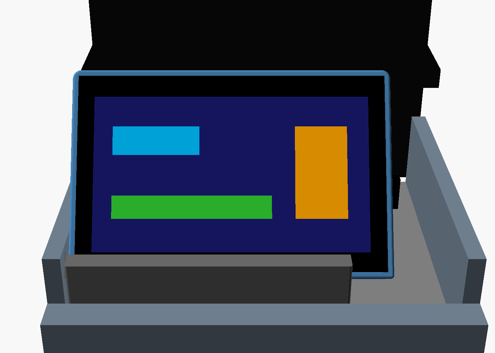

# Ioniq 6 display on the ESP32

*[Deutsch](README.md) · English*

Firmware for the **Waveshare ESP32-S3-Touch-LCD-4.3** (ESP32-S3, 4.3" landscape display 800×480, 16 MB flash, 8 MB PSRAM, GT911 touch, microSD). The board connects to the OBD adapter over Bluetooth and shows the values on eight pages.

Status: **firmware 86** (31 Oct 2026).

**Quirks of the 4.3" board:** no battery gauge (the battery sits behind a voltage converter without a measuring point), backlight only on/off via the CH422G port expander (dimming is therefore done in software), no usable BOOT button (GPIO 0 is a display line, BOOT only works for flashing). Wake from sleep by touching; from "Power off" only with RESET. Pins: I2C SDA 8 / SCL 9 (touch 0x5D, CH422G), touch INT 4, SD via SPI MOSI 11 / SCK 12 / MISO 13 (CS on the CH422G).



Plus two hidden sub-pages without their own tab: swiping up or down on Battery opens the cells, on Drivetrain the g-force (swipe again to go back).



*Rendered with sample values from the real display code (`test_host/sim/render.sh`).*

## Features at a glance

| Feature | In short |
|---|---|
| Seven pages | Drive, Battery, Charging, Drivetrain, Trips, Temperatures, Car, plus hidden Cells (under Battery) and G-force (under Drivetrain) (details below) |
| Controls | Tap a page name at the top = that page; swipe right = next, left = previous, tap anywhere else = next |
| Warnings | Red warning at the top right (instead of the page bar) for tyre pressure below 2.2 bar, cell difference from 100 mV, battery from 50 °C, 12 V below 12.0 V, state of charge below 10 %, insulation below 100 kOhm. Several alternate every 3 s |
| Start screen | Clock, Hyundai logo, status while connecting, buttons Sleep, Power off and Menu |
| Menu | ☰ button at the top right of every page or "Menu" at the bottom of the start screen: Brightness, Language, Settings, View trips, Sleep, Touch test, Demo mode. At the bottom the firmware version and the reason for the last restart |
| Brightness | Sliders for day and night (20–100 %); at night (sun below the horizon) the night value applies |
| Sleep / Power off | Sleep: display off, touch or car on wakes it. Power off: deep sleep, only RESET wakes it |
| Trip log | Every trip from 1 km (the last 20) and totals per month (12 months), stored in flash. Also without the car via menu → "View trips" |
| Automatic | Plugging in the charging cable jumps to the Charging page |
| Logs on SD | One CSV file per trip with all values and raw data |
| Ready and end of trip | Ready via the main relay (744 22E004) plus an answering ESC 730 (since FW 84); when it is off three times in a row: close the log, get the time over home Wi-Fi, wait for the car: 2 min bright, then dark (car or touch wakes it), after 10 min off (only RESET wakes it, since FW 76) |
| Online update | At start-up on home Wi-Fi the ESP fetches new firmware from GitHub (repo configurable). Since FW 79 it is first loaded completely into PSRAM (progress bar), then installed in about 15 s with the display dark, because writing flash distorts the picture |
| Settings | Wi-Fi portal on the phone; backup as `einstellungen.txt` on the SD card, restored automatically after flashing over USB |
| Demo mode | All pages with a simulated drive and fast charge, no car needed |

Confirmed in the car: Bluetooth, all pages, touch, BMS and cell values, remaining energy, speed, Ready via the main relay, clock, SD card, online update. Never seen yet: values during **AC charging** (on-board charger 7E5 22E002); charging values from the charging control unit (744 E002/E003) unconfirmed.

## The pages

- **Drive:** state of charge with remaining energy in kWh (from the BMS) and our own range (remaining energy divided by the consumption of the last up to 25 km; in the first 3 km the average of the last trip). Battery power in large digits (green while charging) with voltage and current, speed from the vehicle control unit (if it doesn't answer, calculated from the rear motor speed). Consumption of the trip and of the last km, recovered kWh, consumption per km of the last 20 km as bars with the trip average as a yellow line, rear and front motor speed, distance and odometer.
- **Battery:** all 16 modules as coloured tiles (the warmest outlined), cell voltage min/max with difference, SoH, 12 V battery, coolant, BMS state of charge, status of battery thermal management (off, pump running, heating on, cooling on) and insulation resistance. Plus the 12 V battery from the 12 V converter (7E5 22E011): state of charge (orange below 70 %, red below 50 %), voltage, current and temperature.
- **Charging:** state of charge and charging power in large digits; during charging the kWh charged, duration, state of charge from/to, peak power, AC/DC, time remaining to 80 % and 100 % (DC slows down above about 80 %, so the time is too optimistic then), the charging curve (kW over state of charge). Plus voltage, current and maximum power of the charging station and the temperature of the charging port. At the top right the BMS status byte. After charging the values stay visible as "Last charge". Depending on the charging type different values at the bottom: for DC the station and requested power, for AC mains voltage, mains current and frequency plus the temperature of the on-board charger (7E5 22E002).
- **Drivetrain:** chassis from above (photo as in the app) with every value at its component: modules as tiles with state of charge in the battery, tyre pressure and temperature in the wheels (orange below 2.4 or above 3.2 bar, red below 2.2 bar), front and rear motor speed, dots on the HV lines (yellow when driving, green when recuperating). At the top speed, power with voltage/current and range, at the bottom 12 V, coolant, thermal management, module temperatures and recuperated kWh. The tyres only report after a few metres of driving.
- **G-force (hidden under Drivetrain, since FW 78):** swipe up or down on the Drivetrain page. Circle with lateral and longitudinal acceleration (dot and trail of the last seconds; since FW 82 as you feel it in the seat: braking up, accelerating down, left turn right), on the right the current value, steering angle and peaks of this trip (accelerating, braking, left/right turn). Source ESC 730 22F010 (wheels and steering angle as in OBDb; acceleration since FW 80 from a test drive: byte 14 longitudinal, 16 lateral, each (raw − 32768) / 1000 m/s², OBDb had the axes swapped and 8 times too small; when standing, longitudinal shows the slope); polled about 5 times per second on this page, otherwise every round. Log column `raw_730_22F010`.
- **Cells (hidden under Battery, since FW 80):** swipe up or down on the Battery page. All 192 cell voltages as bars (lowest red, highest orange) with difference (yellow from 50 mV). Below that the battery's lifetime: total kWh charged and discharged, full cycles, operating hours, lifetime average in kWh/100 km and number and energy of AC and DC charging sessions.
- **Trips:** the last 10 trips with start, km, consumption (orange above 25 kWh/100 km) and state of charge from–to, below that the last 5 months with trips, km, kWh and average. Date and month need the time from Wi-Fi; without a clock "-" is shown.
- **Temperatures** ("Temp."): outside and cabin, battery min/max, inlet, coolant and thermal management, rear motor, inverter and heatsink. No source is known for the front motor.
- **Car** (since FW 74): top view in Biophilic Blue Pearl. Open doors swing out in orange, an open boot lid turns orange, low beam as a light cone, tail light and brake light as a red band. When a door or lid opens, the display jumps to this page and back after closing. Source: body control unit 770 (22BC03 doors/low beam, 22BC06 brake light, 22BC10 light code); the door bits come from the Kia EV9 (OBDb) and are still **unconfirmed** on the Ioniq 6, which is why the raw line "770 BC03" is shown at the bottom. Frunk bit unknown. Log columns raw_770_22BC03/06/10. Graphic: esp32/tools/car_top_img.py from a blueprint.



The BMS is polled every 2 s. Speed comes every round, the main relay (Ready) every round once Ready, otherwise every third, climate and rear motor every 10 s (every round on the Temperatures page), tyres every 10 s (every 2 s on the Drivetrain page), the charging control unit only while charging. Control units that don't answer three times are only asked rarely after that. Which values come from where is listed in the [main description](../README.en.md#data-sources).

## Start screen and menu



The start screen shows the clock at the top left (once the ESP has fetched it over Wi-Fi), the Hyundai logo on the right. Above it are the status messages, such as "Searching OBD adapter …".

The menu opens via ☰ at the top right of every page or "Menu" at the bottom of the start screen:

- **Brightness:** one slider each (minus, bar, plus) for day and night, at least 20 %. The display can only switch its light on/off, so colours are dimmed in software. At night (sun position for central Germany, needs the time from Wi-Fi) the night value applies if it is darker.
- **Language:** switches between German and English.
- **Settings:** opens the settings page (see below). Pressing the display for 3 s does the same.
- **View trips:** the trip log, also without the car. Tap or swipe to close.
- **Sleep** (also a button on the start screen): display off, Bluetooth disconnected, slower clock. Touching the display wakes it, as does the car if it was off after falling asleep and turns on again (checked every minute).
- **Power off** (button to the right of "Sleep" on the start screen): close the log, save settings, then deep sleep without a wake-up source. Only the RESET button starts it again (through the opening in the enclosure). The converter and display electronics still draw a little current.
- **Touch test:** realign the touch.
- **Demo mode.**

## OBD adapter

The ESP connects automatically. On the first start it takes the first Bluetooth adapter whose name looks like an OBD adapter (vLink, iCar, Vgate, OBD, ELM) and remembers it; after that it only looks for this one. After a dropout it reconnects by itself. For a different dongle press "Forget adapter" on the settings page.

ELM327 adapters with **Bluetooth Low Energy** work (e.g. Vgate iCar 2/Pro, vLinker MC+/FS, OBDLink CX). Classic Bluetooth adapters without BLE don't work, because the ESP32-S3 only supports BLE. Tested with the Vgate iCar 2.

## Touch test

Depending on the board, the touch chip reports its coordinates rotated or mirrored. On the first start and via menu → "Touch test", tap four crosses in the corners one after another; the firmware learns direction and scale from them and remembers them. Then a test screen for drawing follows. "Done" at the bottom finishes, "Calibrate again" at the top starts over.



## Demo mode

Menu → "Demo mode", or tap five times quickly while there is no connection to the car yet. All pages then run with simulated values: a drive across the country, on the Charging page a fast charge in time-lapse. "DEMO" is shown in yellow at the top. No Bluetooth, no log. Tap five times again to end it.



## Logs only on the SD card

This public edition uploads nothing: logs stay on the microSD card, no GitHub key is needed. Wi-Fi is only used for updates and the clock.

## Settings and online update

Menu → Settings (or press the display for 3 s): the ESP opens the Wi-Fi "Ioniq6-Display" (password `ioniq6obd`). Connect with your phone and open `192.168.4.1` in the browser. There you can enter or set:

- home Wi-Fi and password
- update repo (owner/name, default `Darshumar/ioniq6-display`; the firmware is in `esp32/firmware/ws43/` there, branch main)
- rotate the display by 180° (brightness for day and night is set in the menu on the display)
- forget adapter, download logs from the SD card, "Check for update now"

Tap the display to return to the dashboard.

**Backup on the SD card:** all settings (Wi-Fi, update repo, brightness, rotation, remembered adapter, touch calibration) are stored in the ESP and as a copy in `einstellungen.txt` on the SD card, in plain text, including the Wi-Fi password. Flashing over USB at 0x0 erases the ESP's storage; if the Wi-Fi is missing afterwards, the ESP restores the file and restarts.

**Your own repo:** to run the display from your own repo, put the firmware files (`version.txt`, `ioniq6_display_app.bin`) into `esp32/firmware/ws43/` of your repo and enter it as the update repo.

**Update:** at start-up the ESP briefly looks for the home Wi-Fi. If it finds it, it requests `esp32/firmware/ws43/version.txt` and installs a newer version by itself. Without Wi-Fi in range it continues after about 2 s. A version that doesn't start after installation is not loaded automatically a second time.

**Wi-Fi and Bluetooth** share one radio on the ESP32-S3. That's why Wi-Fi is only on briefly (at start-up and, if the clock is missing, at the end of a trip) and always off while driving.

## Logs on the SD card

With a microSD card (FAT32) in the slot, the ESP writes one CSV file per trip to `/logs`, one line per poll. The columns are the same as in the web app: decoded values, the raw answers of all control units (`raw_220101`, `raw_7E3_22E001` etc.), since firmware 70 `ready` (main relay 0/1), `car_state` (0 off, 1 ignition, 2 Ready, 3 charging) and the cell blocks `raw_220102` … `raw_22010C`. Next to it, it writes a small diagnostic file `diag_*.csv` every 5 s (flash accesses, Bluetooth, free memory). The file is only created with the first data from the car. "SD" is shown at the top of the display while logging. When the card runs low (less than 50 MB free), it deletes the oldest logs.

The file name contains the date and time of the start of the trip (`20261019_181255.csv`). If the clock wasn't set at start-up, the file is first called `start_<no>.csv` and is renamed as soon as the ESP gets the time (at the end of the trip, while waiting for the car or at the next start on home Wi-Fi); the trip in the trip log then also gets its date.

Logs get to the PC or phone via the settings page ("Logs on the SD card") or the card itself.

## End of trip

Since firmware 70 the ESP detects **Ready** from the main relay (charging control 744 22E004, byte 4 bit 2). If Ready was on during this trip and is off three times in a row (a few seconds after switching off; the BMS still answers for about 20 s after that), the trip is over. The relay also drops at the end of charging. Since FW 84 the relay only counts as Ready if the ESC (730 22F010) also answers or a motor turns: a few minutes after parking, the car recharges the 12 V battery by itself (14.4 V, relay on, 15–25 min), and the ESC stays silent then. Without Ready, recording ends after 5 min (except during HV charging). While waiting for the car, only an answering ESC or HV charging wakes it, not the voltage alone. If Ready was never seen (e.g. ignition only), the old method applies: the BMS doesn't answer five times and the 12 V voltage is below 13 V (the adapter measures it itself), at the latest after 30 failed attempts. The 12 V alone are not reliable; they swing between 12.5 and 13.4 V while driving.

Then the ESP

1. closes the log,
2. gets the time over home Wi-Fi if it is still missing (the logs stay on the card),
3. shows "Waiting for the car"; after 2 minutes the display goes dark (the car or touch wakes it), after 10 minutes it switches off completely like "Power off" (only RESET starts it again, since FW 76).

Every minute it briefly connects to the adapter and checks whether the car is on; if so, the display restarts. In between, the menu and "View trips" can be used.

## Battery on the ESP

The 4.3" board has a battery connector but cannot measure the battery voltage, so there is no battery gauge. The brownout detector stays disabled so that a short dip when unplugging USB doesn't trigger a restart.

## Enclosure



Printed and in the car: tray 27 mm deep with the battery under the board, openings for both USB-C ports and for BOOT/RESET, 4 × M2.5 × 16 socket head screws. The stand clamps into the left area of the tray in front of the cup holders and holds the display tilted back 35°; a rib in the slot engages a groove in the tray against sideways slipping. Details, dimensions and STL files: [enclosure/ws43/](enclosure/ws43/README.en.md).

## Flashing over USB (Windows)

Ready-made firmware: `firmware/ws43/ioniq6_display_merged.bin`. Only needed the very first time; after that, updates come over Wi-Fi.

1. Connect the board to the PC via USB-C.
2. Once: `py -m pip install esptool`
3. Flash:

   ```
   py -m esptool --chip esp32s3 write_flash 0x0 esp32\firmware\ws43\ioniq6_display_merged.bin
   ```

   If esptool doesn't find the board: hold BOOT, briefly press RESET, release BOOT, try again (the BOOT button only works for flashing).

4. Then press RESET once.

The board's messages come over USB at 115200 baud (`py -m serial.tools.miniterm COM5 115200`, first `py -m pip install pyserial`).

## Building it yourself

**Arduino IDE:** boards manager "esp32" by Espressif **3.1.3** (since firmware 57; with 2.0.17 the picture flickered when redrawing). Libraries: *GFX Library for Arduino* 1.6.5, *NimBLE-Arduino* 1.4.3, *U8g2*. Board "ESP32S3 Dev Module", PSRAM "OPI PSRAM", Flash Size "16MB", Partition Scheme "16M Flash (3MB APP/9.9MB FATFS)", USB CDC On Boot "Enabled". In addition, the linker needs three switches (otherwise a restart loop from the brownout detector or a crash while writing flash): in a `platform.local.txt` next to the `platform.txt` of the esp32 core, the line
`compiler.c.elf.extra_flags=-Wl,--wrap=esp_brownout_init -Wl,--wrap=spi_flash_disable_interrupts_caches_and_other_cpu -Wl,--wrap=spi_flash_enable_interrupts_caches_and_other_cpu`
(arduino-cli: the same via `--build-property`). Then open the folder `ioniq6_display`.

**PlatformIO:** `pio run -t upload` in the folder `esp32` (environment `ws43`).

**Publishing a new version:** increase `FW_VERSION` in `ioniq6_display/version.h`, **then** build and run `tools/release.sh`. The script checks that the built file contains the version from `version.h` and puts the USB image, update file and `version.txt` into `firmware/ws43/` (the ESP looks there via `FW_DIR` from `board.h`). Then commit and push.

## Structure

| File | Content |
|---|---|
| `ioniq6_display/main.cpp` | Flow: connect, poll, menu, end of trip, waiting |
| `ioniq6_display/elm_ble.cpp` | BLE connection to the adapter (NimBLE) |
| `ioniq6_display/decode.cpp` | Decoding of all control units, state off/ignition/Ready/charging |
| `ioniq6_display/ui.cpp` | Display (Arduino_GFX, RGB panel 800×480) |
| `ioniq6_display/i18n.h` | German/English texts (`T("de", "en")`) |
| `ioniq6_display/logo.h` | Hyundai logo for the start screen |
| `ioniq6_display/demo.cpp` | Demo mode |
| `ioniq6_display/touch.cpp` | Touch (GT911, I2C 0x5D/0x14) |
| `ioniq6_display/exio.cpp` | CH422G port expander (backlight, resets, SD CS) |
| `ioniq6_display/board.h` | Board selection, pins, update folder, `LOG_UPLOAD` switch (0 = no upload) |
| `ioniq6_display/trips.cpp` | Trip log in flash |
| `ioniq6_display/sdlog.cpp` | Logs on the SD card |
| `ioniq6_display/ota.cpp` | Wi-Fi, clock, online update, settings page |
| `ioniq6_display/settings.cpp` | Backup of the settings on the SD card |
| `ioniq6_display/chassis_img.h` | Chassis picture for the Drivetrain page (`tools/chassis_img.py`) |
| `ioniq6_display/version.h` | Firmware version |
| `test_host/sim/` | Renders all images in `docs/` on a PC (`render.sh <Arduino libraries>`) |

Pins (4.3"): display RGB DE 5, VSYNC 3, HSYNC 46, PCLK 7, R 1/2/42/41/40, G 39/0/45/48/47/21, B 14/38/18/17/10; touch and CH422G I2C SDA 8, SCL 9, touch INT 4; SD card SPI MOSI 11, SCK 12, MISO 13 (CS via CH422G); CAN would be on GPIO 15/16.
