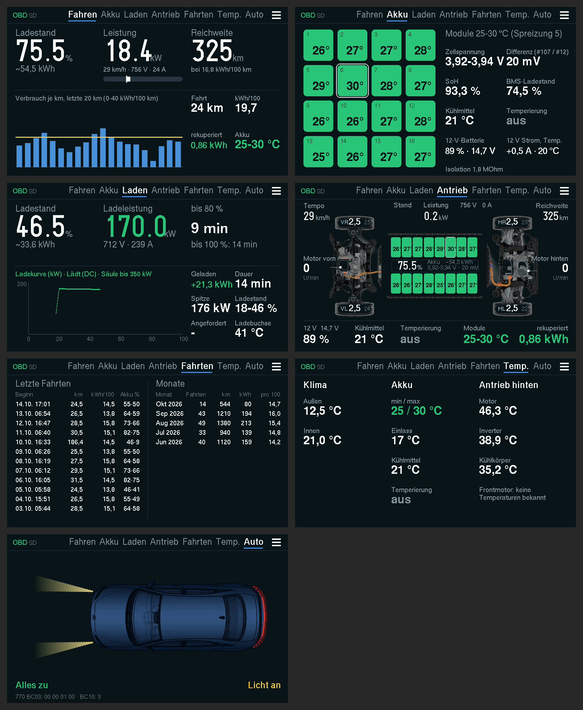
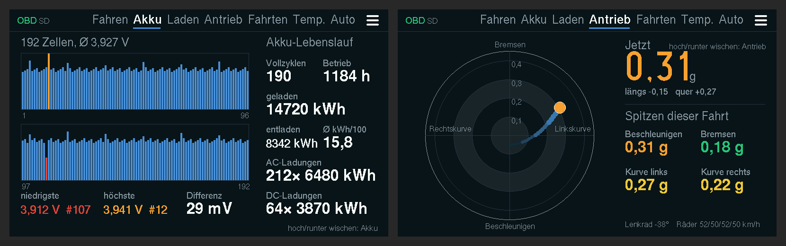
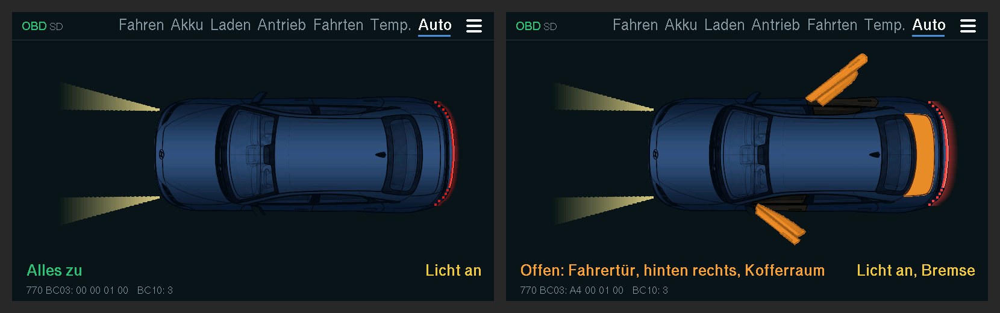
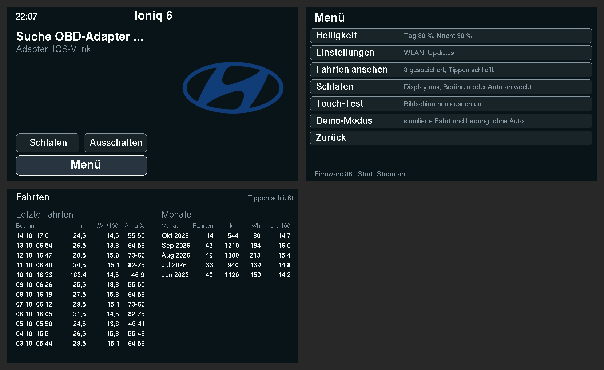
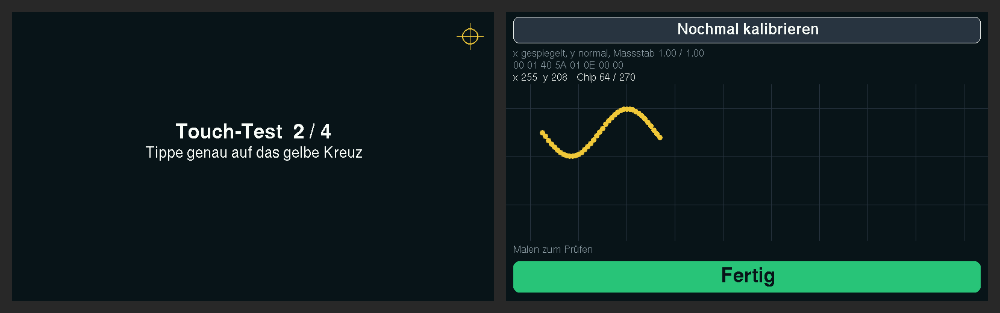
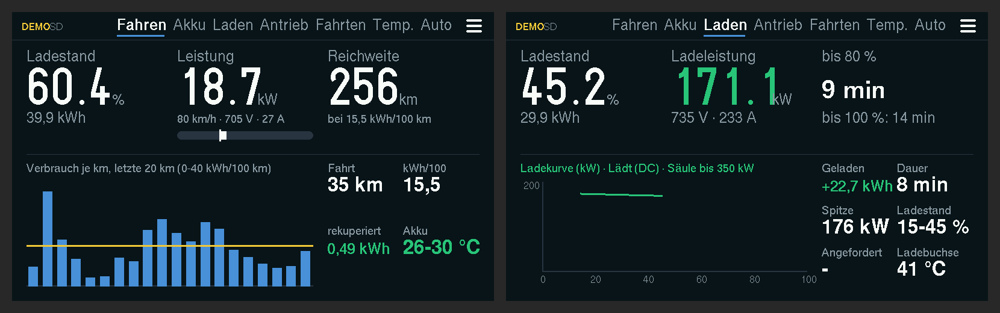
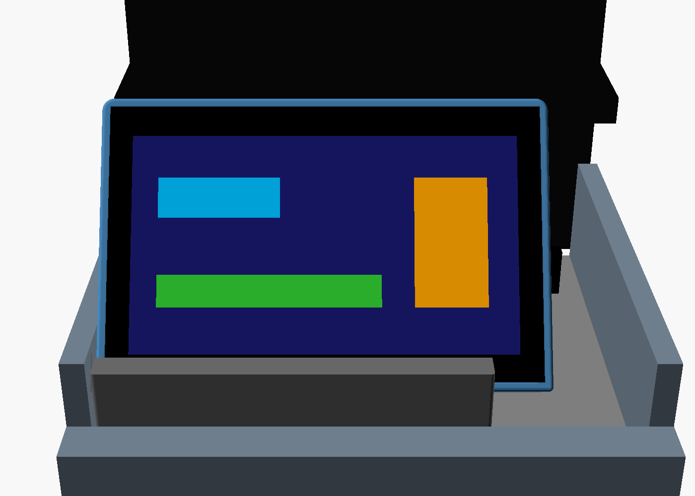

# Ioniq 6 Anzeige auf dem ESP32

*Deutsch · [English](README.en.md)*

Firmware für das **Waveshare ESP32-S3-Touch-LCD-4.3** (ESP32-S3, 4,3"-Display quer 800×480, 16 MB Flash, 8 MB PSRAM, Touch GT911, microSD). Das Board verbindet sich per Bluetooth mit dem OBD-Adapter und zeigt die Werte auf acht Seiten.

Stand: **Firmware 86** (31.10.2026).

**Eigenheiten des 4.3"-Boards:** keine Akkuanzeige (der Akku hängt hinter einem Spannungswandler ohne Messpunkt), Licht nur an/aus über den Portexpander CH422G (gedimmt wird deshalb in Software), keine nutzbare BOOT-Taste (GPIO 0 ist eine Displayleitung, BOOT geht nur zum Flashen). Aufwecken aus dem Schlaf durch Berühren, aus „Ausschalten“ nur mit RESET. Pins: I2C SDA 8 / SCL 9 (Touch 0x5D, CH422G), Touch-INT 4, SD per SPI MOSI 11 / SCK 12 / MISO 13 (CS am CH422G).



Dazu zwei versteckte Unterseiten ohne eigenen Reiter: auf Akku hoch oder runter wischen öffnet die Zellen, auf Antrieb die G-Kraft (nochmal wischen führt zurück).



*Mit Beispielwerten aus dem echten Display-Code gerendert (`test_host/sim/render.sh`).*

## Funktionen auf einen Blick

| Funktion | Kurz erklärt |
|---|---|
| Sieben Seiten | Fahren, Akku, Laden, Antrieb, Fahrten, Temperaturen, Auto, dazu versteckt Zellen (unter Akku) und G-Kraft (unter Antrieb) (Details unten) |
| Bedienung | Seitenname oben antippen = diese Seite; nach rechts wischen = nächste, nach links = vorige, Tippen sonst = weiter |
| Warnungen | Rote Warnung oben rechts (statt der Seitenleiste) bei Reifendruck unter 2,2 bar, Zelldifferenz ab 100 mV, Akku ab 50 °C, 12 V unter 12,0 V, Ladestand unter 10 %, Isolation unter 100 kOhm. Mehrere wechseln alle 3 s |
| Startbildschirm | Uhrzeit, Hyundai-Logo, Status beim Verbinden, Schaltflächen Schlafen, Ausschalten und Menü |
| Menü | Schaltfläche ☰ oben rechts auf jeder Seite bzw. „Menü“ unten auf dem Startbildschirm: Helligkeit, Einstellungen, Fahrten ansehen, Schlafen, Touch-Test, Demo-Modus. Unten Firmware-Version und Grund des letzten Neustarts |
| Helligkeit | Regler für Tag und Nacht (20–100 %), nachts (Sonne unter dem Horizont) gilt der Nacht-Wert |
| Schlafen / Ausschalten | Schlafen: Display aus, Berühren oder Auto an weckt. Ausschalten: Tiefschlaf, nur RESET weckt |
| Fahrtenbuch | Jede Fahrt ab 1 km (die letzten 20) und Summen je Monat (12 Monate), im Flash gespeichert. Auch ohne Auto über Menü → „Fahrten ansehen“ |
| Automatik | Beim Einstecken des Ladekabels springt die Anzeige auf die Lade-Seite |
| Logs auf SD | Eine CSV-Datei pro Fahrt mit allen Werten und Rohdaten |
| Ready und Fahrtende | Ready über das Hauptrelais (744 22E004) plus antwortende ESC 730 (seit FW 84); ist es dreimal in Folge aus: Log abschließen, im Heim-WLAN die Uhrzeit holen, auf das Auto warten: 2 min hell, dann dunkel (Auto oder Berühren weckt), nach 10 min aus (nur RESET weckt, seit FW 76) |
| Online-Update | Beim Start im Heim-WLAN holt sich der ESP neue Firmware von GitHub (Repo einstellbar). Seit FW 79 erst komplett in den PSRAM geladen (Fortschrittsbalken), dann bei dunklem Display ca. 15 s installiert, weil Flash-Schreiben das Bild verzerrt |
| Einstellungen | WLAN-Portal am Handy; Sicherung als `einstellungen.txt` auf der SD-Karte, nach Kabel-Flashen automatisch zurückgeladen |
| Demo-Modus | Alle Seiten mit simulierter Fahrt und Schnellladung, ohne Auto |

Am Auto bestätigt: Bluetooth, alle Seiten, Touch, BMS- und Zellwerte, Restenergie, Tempo, Ready über das Hauptrelais, Uhrzeit, SD-Karte, Online-Update. Noch nie gesehen: Werte beim **AC-Laden** (Bordlader 7E5 22E002); Ladewerte der Ladesteuerung (744 E002/E003) unbestätigt.

## Die Seiten

- **Fahren:** Ladestand mit Restenergie in kWh (vom BMS) und eigene Reichweite (Restenergie geteilt durch den Verbrauch der letzten bis zu 25 km; in den ersten 3 km der Schnitt der letzten Fahrt). Akkuleistung groß (grün beim Laden) mit Spannung und Strom, Tempo vom Fahrzeugrechner (ohne Antwort aus der Drehzahl des Heckmotors berechnet). Verbrauch der Fahrt und des letzten km, zurückgewonnene kWh, Verbrauch je km der letzten 20 km als Balken mit dem Fahrtschnitt als gelbe Linie, Drehzahl hinten und vorne, Strecke und km-Stand.
- **Akku:** alle 16 Module als farbige Kacheln (das wärmste umrandet), Zellspannung min/max mit Differenz, SoH, 12-V-Batterie, Kühlmittel, BMS-Ladestand, Status der Akku-Temperierung (aus, Pumpe läuft, Heizung an, Kühlung an) und Isolationswiderstand. Dazu die 12-V-Batterie aus dem 12-V-Wandler (7E5 22E011): Ladestand (orange unter 70 %, rot unter 50 %), Spannung, Strom und Temperatur.
- **Laden:** Ladestand und Ladeleistung groß; während der Ladung geladene kWh, Dauer, Ladestand von/bis, Spitzenleistung, AC/DC, Restzeit bis 80 % und 100 % (DC wird oberhalb von etwa 80 % langsamer, die Zeit ist dann zu optimistisch), die Ladekurve (kW über Ladestand). Dazu Spannung, Strom und Maximalleistung der Säule und die Temperatur der Ladebuchse. Rechts oben das Statusbyte des BMS. Nach der Ladung bleiben die Werte als „Letzte Ladung“ stehen. Je nach Ladeart unten andere Werte: bei DC Säule und angeforderte Leistung, bei AC Netzspannung, Netzstrom und Frequenz sowie die Temperatur des Bordladers (7E5 22E002).
- **Antrieb:** Fahrgestell von oben (Foto wie in der App) mit jedem Wert an seinem Bauteil: Module als Kacheln mit Ladestand im Akku, Reifendruck und -temperatur in den Rädern (orange unter 2,4 oder über 3,2 bar, rot unter 2,2 bar), Drehzahl vorn und hinten, Punkte auf den HV-Leitungen (gelb beim Antreiben, grün beim Rekuperieren). Oben Tempo, Leistung mit Spannung/Strom und Reichweite, unten 12 V, Kühlmittel, Temperierung, Modultemperaturen und rekuperierte kWh. Die Reifen melden sich erst nach ein paar Metern Fahrt.
- **G-Kraft (versteckt unter Antrieb, seit FW 78):** Auf der Antrieb-Seite hoch oder runter wischen. Kreis mit Quer- und Längsbeschleunigung (Punkt und Spur der letzten Sekunden; seit FW 82 so, wie man es im Sitz spürt: Bremsen oben, Beschleunigen unten, Linkskurve rechts), rechts aktueller Wert, Lenkwinkel und Spitzen dieser Fahrt (Beschleunigen, Bremsen, Kurve links/rechts). Quelle ESC 730 22F010 (Räder und Lenkwinkel wie OBDb; Beschleunigung seit FW 80 nach Marcs Fahrt am 27.10.: Byte 14 längs, 16 quer, je (roh − 32768) / 1000 m/s², OBDb hatte die Achsen vertauscht und 8-fach zu klein; im Stand zeigt längs die Hangneigung); auf der Seite etwa 5-mal pro Sekunde abgefragt, sonst jede Runde. Log-Spalte `raw_730_22F010`.
- **Zellen (versteckt unter Akku, seit FW 80):** Auf der Akku-Seite hoch oder runter wischen. Alle 192 Zellspannungen als Balken (niedrigste rot, höchste orange) mit Differenz (gelb ab 50 mV). Darunter der Akku-Lebenslauf: insgesamt geladene und entnommene kWh, Vollzyklen, Betriebsstunden, Lebensschnitt in kWh/100 km sowie Zahl und Energie der AC- und DC-Ladungen.
- **Fahrten:** die letzten 10 Fahrten mit Beginn, km, Verbrauch (orange über 25 kWh/100 km) und Ladestand von–bis, darunter die letzten 5 Monate mit Fahrten, km, kWh und Schnitt. Datum und Monat brauchen die Uhrzeit aus dem WLAN; ohne Uhr steht „-“.
- **Temperaturen** („Temp.“): außen und innen, Akku min/max, Einlass, Kühlmittel und Temperierung, Heckmotor, Inverter und Kühlkörper. Für den Frontmotor ist keine Quelle bekannt.
- **Auto** (seit FW 74): Draufsicht in Biophilic Blue Pearl. Offene Türen klappen orange auf, offene Kofferraumklappe wird orange, Abblendlicht als Lichtkegel, Rücklicht und Bremslicht als rotes Band. Geht eine Tür oder Klappe auf, springt das Display auf diese Seite und nach dem Schließen zurück. Quelle: Karosserie-Steuergerät 770 (22BC03 Türen/Abblendlicht, 22BC06 Bremslicht, 22BC10 Lichtcode); die Türbits stammen vom Kia EV9 (OBDb) und sind am Ioniq 6 noch **unbestätigt**, deshalb steht unten die Rohzeile „770 BC03“. Frunk-Bit unbekannt. Log-Spalten raw_770_22BC03/06/10. Grafik: esp32/tools/car_top_img.py aus Marcs Blaupause.



Abgefragt wird das BMS alle 2 s. Tempo kommt jede Runde, das Hauptrelais (Ready) jede Runde ab Ready, sonst jede dritte, Klima und Heckmotor alle 10 s (auf der Temperatur-Seite jede Runde), Reifen alle 10 s (auf der Antrieb-Seite alle 2 s), die Ladesteuerung nur beim Laden. Steuergeräte, die dreimal nicht antworten, werden nur noch selten gefragt. Welche Werte woher kommen, steht in der [Hauptbeschreibung](../README.md#datenquellen).

## Startbildschirm und Menü



Der Startbildschirm zeigt oben links die Uhrzeit (sobald der ESP sie einmal im WLAN geholt hat), rechts das Hyundai-Logo. Darüber stehen die Statusmeldungen, etwa „Suche OBD-Adapter …“.

Das Menü öffnet sich über ☰ oben rechts auf jeder Seite oder „Menü“ unten auf dem Startbildschirm:

- **Helligkeit:** je ein Regler (Minus, Balken, Plus) für Tag und Nacht, mindestens 20 %. Das Display kann nur Licht an/aus, deshalb werden die Farben in Software abgedunkelt. Nachts (Sonnenstand für die Mitte Deutschlands, braucht die Uhrzeit aus dem WLAN) gilt der Nacht-Wert, sofern er dunkler ist.
- **Einstellungen:** öffnet die Einstellungsseite (siehe unten). Dasselbe passiert, wenn man 3 s aufs Display drückt.
- **Fahrten ansehen:** das Fahrtenbuch, auch ohne Auto. Tippen oder Wischen schließt.
- **Schlafen** (auch als Schaltfläche auf dem Startbildschirm): Display aus, Bluetooth getrennt, langsamer Takt. Berühren des Displays weckt ihn, ebenso das Auto, wenn es nach dem Einschlafen aus war und wieder angeht (Prüfung jede Minute).
- **Ausschalten** (Schaltfläche rechts neben „Schlafen“ auf dem Startbildschirm): Log abschließen, Einstellungen sichern, dann Tiefschlaf ohne Wecker. Nur die RESET-Taste startet ihn wieder (durch die Öffnung im Gehäuse). Wandler und Display-Elektronik ziehen dabei weiter etwas Strom.
- **Touch-Test:** Touch neu ausrichten.
- **Demo-Modus.**

## OBD-Adapter

Der ESP verbindet sich automatisch. Beim ersten Start nimmt er den ersten Bluetooth-Adapter, dessen Name nach OBD-Adapter aussieht (vLink, iCar, Vgate, OBD, ELM), und merkt ihn sich; danach sucht er nur noch diesen. Nach einem Abbruch verbindet er sich selbst neu. Für einen anderen Dongle auf der Einstellungsseite „Adapter vergessen“ drücken.

Es gehen ELM327-Adapter mit **Bluetooth Low Energy** (z. B. Vgate iCar 2/Pro, vLinker MC+/FS, OBDLink CX). Klassische Bluetooth-Adapter ohne BLE gehen nicht, weil der ESP32-S3 nur BLE kann. Getestet ist der Vgate iCar 2.

## Touch-Test

Der Touch-Chip meldet seine Koordinaten je nach Board gedreht oder gespiegelt. Beim ersten Start und über Menü → „Touch-Test“ nacheinander vier Kreuze in den Ecken antippen; die Firmware lernt daraus Richtung und Maßstab und merkt sie sich. Danach kommt ein Prüfbild zum Malen. „Fertig“ unten beendet, „Nochmal kalibrieren“ oben fängt neu an.



## Demo-Modus

Menü → „Demo-Modus“, oder solange noch keine Verbindung zum Auto steht fünfmal schnell tippen. Alle Seiten laufen dann mit simulierten Werten: eine Fahrt über Land, auf der Lade-Seite eine Schnellladung im Zeitraffer. Oben steht gelb „DEMO“. Kein Bluetooth, kein Log. Nochmal fünfmal tippen beendet ihn.



## Logs nur auf der SD-Karte

Diese öffentliche Ausgabe lädt nichts hoch: Logs bleiben auf der microSD-Karte, ein GitHub-Schlüssel ist nicht nötig. Das WLAN dient nur für Updates und die Uhrzeit.

## Einstellungen und Online-Update

Menü → Einstellungen (oder 3 s aufs Display drücken): Der ESP öffnet das WLAN „Ioniq6-Display“ (Passwort `ioniq6obd`). Mit dem Handy verbinden und im Browser `192.168.4.1` öffnen. Dort lassen sich eintragen bzw. einstellen:

- Heim-WLAN und Passwort
- Update-Repo (Besitzer/Name, Standard `Darshumar/ioniq6-display`; die Firmware liegt dort in `esp32/firmware/ws43/`, Branch main)
- Display um 180° drehen (Helligkeit für Tag und Nacht stellt man im Menü am Display ein)
- Adapter vergessen, Logs von der SD-Karte herunterladen, „Jetzt nach Update suchen“

Aufs Display tippen führt zurück zur Anzeige.

**Sicherung auf der SD-Karte:** Alle Einstellungen (WLAN, Update-Repo, Helligkeit, Drehung, gemerkter Adapter, Touch-Kalibrierung) liegen im ESP und als Kopie in `einstellungen.txt` auf der SD-Karte, im Klartext, auch das WLAN-Passwort. Ein Kabel-Flashen an 0x0 löscht den Speicher des ESP; fehlt danach das WLAN, lädt der ESP die Datei zurück und startet neu.

**Eigene Nutzung:** Wer die Anzeige mit eigenem Repo betreiben will, legt die Firmware-Dateien (`version.txt`, `ioniq6_display_app.bin`) in `esp32/firmware/ws43/` seines Repos ab und trägt dieses als Update-Repo ein.

**Update:** Beim Start sucht der ESP kurz das Heim-WLAN. Findet er es, fragt er `esp32/firmware/ws43/version.txt` ab und installiert eine neuere Version selbst. Ohne WLAN in Reichweite geht es nach etwa 2 s weiter. Eine Version, die nach der Installation nicht startet, lädt er kein zweites Mal automatisch.

**WLAN und Bluetooth** teilen sich auf dem ESP32-S3 einen Funk. Deshalb ist das WLAN nur kurz an (beim Start und, falls die Uhrzeit fehlt, am Fahrtende) und während der Fahrt immer aus.

## Logs auf der SD-Karte

Steckt eine microSD-Karte (FAT32) im Slot, schreibt der ESP pro Fahrt eine CSV-Datei nach `/logs`, eine Zeile pro Abfrage. Die Spalten sind dieselben wie bei der Web-App: dekodierte Werte, die Rohantworten aller Steuergeräte (`raw_220101`, `raw_7E3_22E001` usw.), seit Firmware 70 `ready` (Hauptrelais 0/1), `car_state` (0 aus, 1 Zündung, 2 Ready, 3 Laden) und die Zellblöcke `raw_220102` … `raw_22010C`. Daneben schreibt er alle 5 s eine kleine Diagnosedatei `diag_*.csv` (Flash-Zugriffe, Bluetooth, freier Speicher). Die Datei entsteht erst mit den ersten Daten vom Auto. Oben in der Anzeige steht „SD“, solange geloggt wird. Wird die Karte knapp (unter 50 MB frei), löscht er die ältesten Logs.

Der Dateiname enthält Datum und Uhrzeit des Fahrtbeginns (`20261019_181255.csv`). War die Uhr beim Start noch nicht gestellt, heißt die Datei erst `start_<Nr>.csv` und wird umbenannt, sobald der ESP die Uhrzeit bekommt (am Fahrtende, beim Warten auf das Auto oder beim nächsten Start im Heim-WLAN); auch die Fahrt im Fahrtenbuch bekommt dann ihr Datum.

Auf den PC oder das Handy kommen die Logs über die Einstellungsseite („Logs auf der SD-Karte“) oder die Karte selbst.

## Fahrtende

Seit Firmware 70 erkennt der ESP **Ready** am Hauptrelais (Ladesteuerung 744 22E004, Byte 4 Bit 2). War Ready in dieser Fahrt an und ist es dreimal in Folge aus (wenige Sekunden nach dem Ausschalten; das BMS antwortet danach noch etwa 20 s), ist die Fahrt zu Ende. Auch am Ladeende fällt das Relais ab. Seit FW 84 zählt das Relais nur als Ready, wenn auch die ESC (730 22F010) antwortet oder ein Motor dreht: einige Minuten nach dem Abstellen lädt das Auto selbst die 12-V-Batterie nach (14,4 V, Relais an, 15–25 min), dabei schweigt die ESC. Ohne Ready endet die Aufnahme nach 5 min (außer beim HV-Laden). Beim Warten auf das Auto weckt nur eine antwortende ESC oder eine HV-Ladung, nicht die Spannung allein. Wurde Ready nie gesehen (z. B. nur Zündung), gilt das alte Verfahren: das BMS antwortet fünfmal nicht und die 12-V-Spannung liegt unter 13 V (der Adapter misst sie selbst), spätestens nach 30 Fehlversuchen. Die 12 V allein taugen nicht, sie pendeln beim Fahren zwischen 12,5 und 13,4 V.

Dann

1. schließt der ESP das Log ab,
2. holt im Heim-WLAN die Uhrzeit, falls sie noch fehlt (die Logs bleiben auf der Karte),
3. zeigt „Warte auf das Auto“, nach 2 Minuten wird das Display dunkel (das Auto oder Berühren weckt es), nach 10 Minuten schaltet es ganz aus wie „Ausschalten“ (nur RESET startet es wieder, seit FW 76).

Jede Minute verbindet er sich kurz mit dem Adapter und prüft, ob das Auto an ist; dann startet die Anzeige neu. Dazwischen sind Menü und „Fahrten ansehen“ bedienbar.

## Akku am ESP

Das 4.3"-Board hat einen Akkuanschluss, kann die Akkuspannung aber nicht messen; eine Akkuanzeige gibt es deshalb nicht. Der Unterspannungswächter bleibt abgeschaltet, damit ein kurzer Einbruch beim Abziehen von USB keinen Neustart auslöst.

## Gehäuse



Gedruckt und im Auto (24.10.): Wanne 27 mm tief mit dem Akku unter dem Board, Öffnungen für beide USB-C-Buchsen und für BOOT/RESET, 4 × M2,5 × 16 Zylinderkopf. Der Ständer klemmt in der linken Fläche der Ablage vor den Getränkehaltern und hält das Display 35° nach hinten geneigt; eine Nase im Schlitz greift in eine Nut der Wanne gegen seitliches Rutschen. Details, Maße und STL-Dateien: [enclosure/ws43/](enclosure/ws43/README.md).

## Flashen per Kabel (Windows)

Fertige Firmware: `firmware/ws43/ioniq6_display_merged.bin`. Nur nötig beim allerersten Mal, danach kommen Updates über WLAN.

1. Board per USB-C an den PC anschließen.
2. Einmalig: `py -m pip install esptool`
3. Flashen:

   ```
   py -m esptool --chip esp32s3 write_flash 0x0 esp32\firmware\ws43\ioniq6_display_merged.bin
   ```

   Findet esptool das Board nicht: BOOT gedrückt halten, kurz RESET, BOOT loslassen, nochmal versuchen (die BOOT-Taste geht nur zum Flashen).

4. Danach einmal RESET drücken.

Die Meldungen des Boards kommen über USB mit 115200 Baud (`py -m serial.tools.miniterm COM5 115200`, vorher `py -m pip install pyserial`).

## Selbst bauen

**Arduino-IDE:** Boardverwalter „esp32“ von Espressif **3.1.3** (seit Firmware 57; mit 2.0.17 flackerte das Bild beim Neuzeichnen). Bibliotheken: *GFX Library for Arduino* 1.6.5, *NimBLE-Arduino* 1.4.3, *U8g2*. Board „ESP32S3 Dev Module“, PSRAM „OPI PSRAM“, Flash Size „16MB“, Partition Scheme „16M Flash (3MB APP/9.9MB FATFS)“, USB CDC On Boot „Enabled“. Zusätzlich braucht der Linker drei Schalter (sonst Neustart-Schleife durch den Unterspannungswächter bzw. Absturz beim Flash-Schreiben): in einer `platform.local.txt` neben der `platform.txt` des esp32-Cores die Zeile
`compiler.c.elf.extra_flags=-Wl,--wrap=esp_brownout_init -Wl,--wrap=spi_flash_disable_interrupts_caches_and_other_cpu -Wl,--wrap=spi_flash_enable_interrupts_caches_and_other_cpu`
(arduino-cli: dasselbe per `--build-property`). Dann den Ordner `ioniq6_display` öffnen.

**PlatformIO:** `pio run -t upload` im Ordner `esp32` (Umgebung `ws43`; die CI nutzt das als Compile-Test, Releases baut arduino-cli).

**Neue Version veröffentlichen:** `FW_VERSION` in `ioniq6_display/version.h` hochzählen, **danach** bauen und `tools/release.sh` aufrufen. Das Skript prüft, dass die gebaute Datei die Version aus `version.h` enthält, und legt Kabel-Abbild, Update-Datei und `version.txt` in `firmware/ws43/` ab (der ESP fragt dort über `FW_DIR` aus `board.h` nach). Dann committen und pushen.

## Aufbau

| Datei | Inhalt |
|---|---|
| `ioniq6_display/main.cpp` | Ablauf: verbinden, abfragen, Menü, Fahrtende, Warten |
| `ioniq6_display/elm_ble.cpp` | BLE-Verbindung zum Adapter (NimBLE) |
| `ioniq6_display/decode.cpp` | Dekodierung aller Steuergeräte, Zustand aus/Zündung/Ready/Laden |
| `ioniq6_display/ui.cpp` | Anzeige (Arduino_GFX, RGB-Panel 800×480) |
| `ioniq6_display/logo.h` | Hyundai-Logo für den Startbildschirm |
| `ioniq6_display/demo.cpp` | Demo-Modus |
| `ioniq6_display/touch.cpp` | Touch (GT911, I2C 0x5D/0x14) |
| `ioniq6_display/exio.cpp` | Portexpander CH422G (Licht, Resets, SD-CS) |
| `ioniq6_display/board.h` | Board-Auswahl, Pins, Update-Ordner, Schalter `LOG_UPLOAD` |
| `ioniq6_display/trips.cpp` | Fahrtenbuch im Flash |
| `ioniq6_display/sdlog.cpp` | Logs auf der SD-Karte |
| `ioniq6_display/ota.cpp` | WLAN, Uhrzeit, Online-Update, Einstellungsseite |
| `ioniq6_display/settings.cpp` | Sicherung der Einstellungen auf der SD-Karte |
| `ioniq6_display/chassis_img.h` | Fahrgestell-Bild der Antrieb-Seite (`tools/chassis_img.py`) |
| `ioniq6_display/version.h` | Firmware-Version |
| `test_host/sim/` | Rendert alle Bilder in `docs/` am PC (`render.sh <Arduino-Bibliotheken>`) |

Pins (4.3"): Display RGB DE 5, VSYNC 3, HSYNC 46, PCLK 7, R 1/2/42/41/40, G 39/0/45/48/47/21, B 14/38/18/17/10; Touch und CH422G I2C SDA 8, SCL 9, Touch-INT 4; SD-Karte SPI MOSI 11, SCK 12, MISO 13 (CS über CH422G); CAN wäre auf GPIO 15/16.
