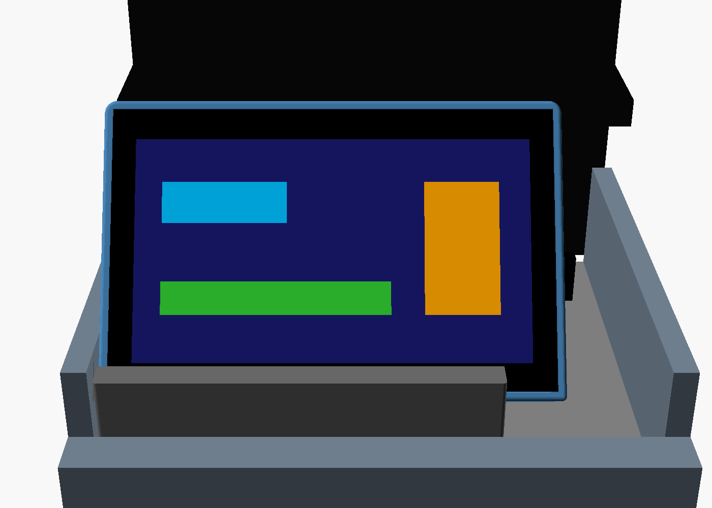
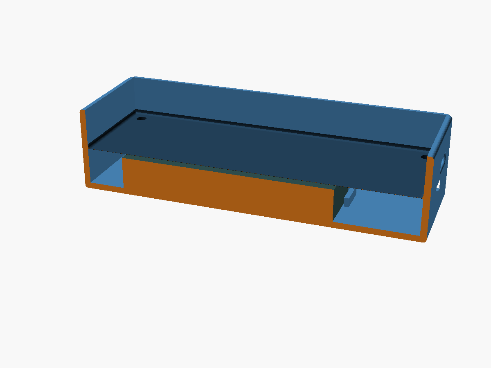
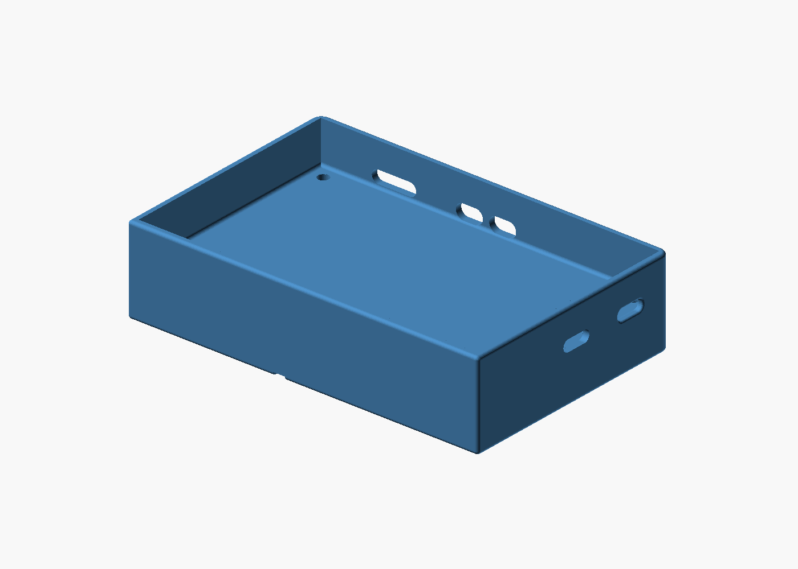
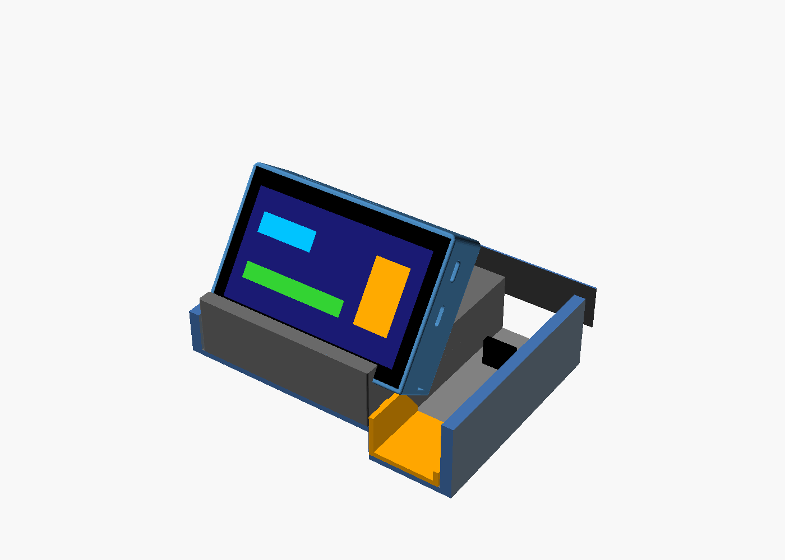
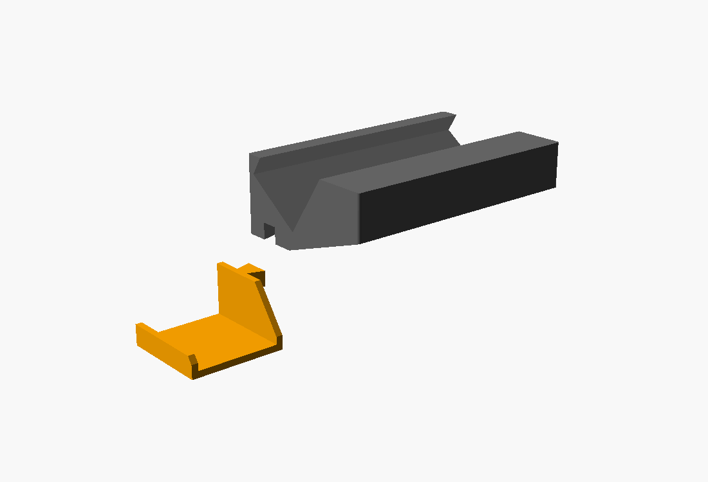
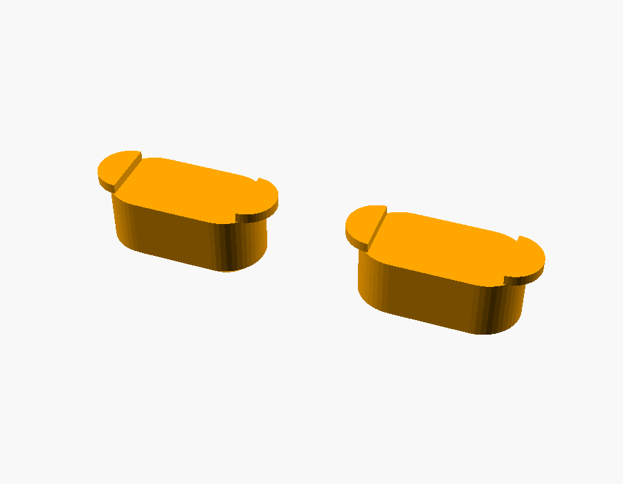
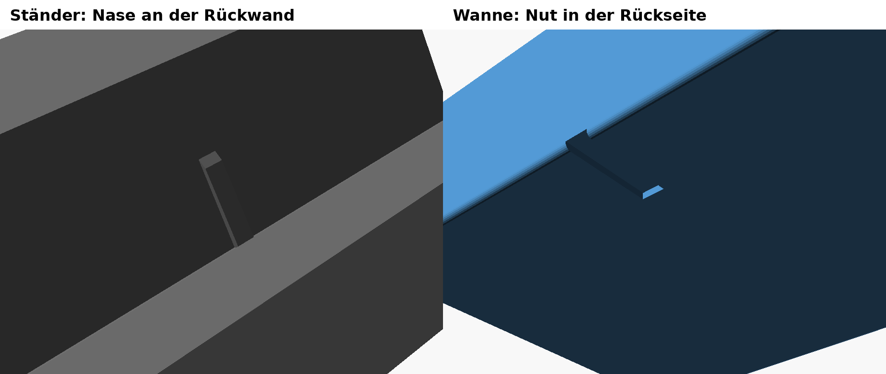

# Enclosure for the Waveshare 4.3" with battery and stand

*[Deutsch](README.md) · English*



Status 24 Oct 2026: **done. Tray and stand with rib printed, everything fits.** Display in the stand tilted back 35°; USB-C and button openings adjusted after the first test print.

| In short | |
|---|---|
| Tray | 111 × 72.6 × 27 mm, battery under the board, 4 × M2.5 × 16 socket head screws from below |
| Openings | 2 × USB-C (UART and USB), BOOT and RESET at the top, groove for the rib at the back |
| Stand | Clamp insert 96 × 61 × 30 mm for the left area of the tray in front of the cup holders, 35° slot |
| Wing | U-profile in the USB recess, plugged into the stand, against slipping to the right |
| Rib | Rib in the stand slot engages the groove of the tray, against sideways slipping |
| Battery | Meshnology 103665, 3.7 V 3000 mAh, PH2.0 |
| Material | PETG or ASA |

## Printing

| Part | File | Orientation |
|---|---|---|
| Tray with battery compartment | `stl/ws43_tray_akku.stl` | bottom down, no supports |
| Stand for the tray | `stl/ws43_staender_akku.stl` | on its left side face, no supports |
| Wing for the USB recess | `stl/ws43_fluegel_mulde.stl` | bottom down, no supports |
| Button caps with collar (2 pieces, inserted from inside) | `stl/ws43_tastenkappen_kragen.stl` | outer side down, no supports |

PETG or ASA (heat in the car), not PLA. Plus 4 × M2.5 × 16 socket head screws (ISO 4762, head recessed in 5.0 × 2.7 mm; M3 doesn't fit the board) and a thin foam pad on the battery.

## Tray



The base is the original tray `stl/ws43_tray_original.stl` (111 × 72.6 × 15 mm outside, board holes 98 × 60 mm, USB cut-out on the right). `ws43_tray_akku.stl` is the same tray, 12 mm deeper (27 mm). It is assembled from the original (bottom with edge rounding, wall profile extended, upper part raised) so that edges and radii stay the same.

In addition to the original's USB-C opening (UART), the tray has a second one for the USB port and, at the top edge, openings for BOOT, RESET and the microSD card (`side_openings()` in the `.scad`, positions measured on the board and adjusted by about 1 mm after the test print).



The battery lies on the bottom between four brackets. The board sits above it on four tall screw posts at the same height as it used to sit on the bottom. Assembly: insert the battery, put the pad on top, insert the board, drive the four screws from below through the posts into the board's standoffs. To change the battery, the board has to come out.

## Battery

Meshnology **103665**, 3.7 V 3000 mAh, PH2.0 connector, with protection circuit (Amazon B0FJ1GX4P6). Nominal size 10 × 36 × 65 mm, in the model 10.5 × 37 × 69 mm (protection board at the cable end, tolerance). **Check the polarity before plugging in:** with PH2.0 batteries from Amazon, red/black is often reversed compared to the board connector. Different battery: change `batt_l`, `batt_w`, `batt_t` (and `batt_x/y` if needed) at the top of `ws43_akkufach.scad`; flat batteries up to about 88 × 60 × 10 mm fit.

## Stand



Clamp insert for the left area of the tray in front of the cup holders (Ioniq 6 centre console), 96 × 61 × 30 mm, plus the plugged-in wing on the right. It sits between the left side wall and the USB niche (felt tape on the sides if needed), at the front against the edge to the cup holders. The underside follows the floor: 23 mm flat at the front, then the shallow ramp (15 mm rise over about 45 mm, estimated from photos, `st_ramp`).

Slot 27.4 mm, tilted back 35° (`st_tilt`), open on both sides. The low side with the front lip (7 mm, `st_lip`; the slot bottom is calculated from it) faces the cup holders, the display faces the driver. Flush on the left, the enclosure overhangs the USB niche by about 15 mm; the display's USB port is on the right, on the side of the car's USB port.

### Wing for the USB recess



A separate wing (`stl/ws43_fluegel_mulde.stl`): a thin U-profile (2.5 mm wall, `wing_wall`) that spans the USB recess up to its right wall (37 mm, 1 mm clearance, `wing_w`) and rests on the recess floor. The right leg (8 mm, `wing_right`) rests against the recess wall, the left against the step. This braces the stand on the right so it no longer slips; the side wall holds it on the left. The recess is 16 mm lower than the left area (`wing_drop`). Behind the flat area the legs drop to 4 mm above the recess floor by a depth of 35 mm (`wing_d`, `wing_top_end`), so the USB housing and plug stay clear.

Connection: at the front the left leg carries a 6 mm high dovetail tenon (`dt_*`) lying on the flat area. The stand has a matching groove at the bottom right (0.25 mm clearance per side, `dt_fit`). First put the wing into the recess, then set the stand on from above. Both parts print without supports.

### Button caps for BOOT and RESET



They fit the button openings without changes to the tray. These caps are inserted from the inside before the board is screwed in and then can't fall out. They have no head: the pin protrudes 1.5 mm outside (`kcap_out`). Behind the wall a 0.5 mm collar sits only at the ends, next to the 6 mm wide button (`kcap_collar`, `kcap_free`). In the middle the plunger presses on the button. `stl/ws43_tastenkappen_kragen.stl` contains two caps (`kcap_tips`).

### Rib against slipping



A 3 mm wide rib on the rear slot wall (1 mm high, 14 mm long from the slot bottom, chamfered at the top) engages a groove open at the bottom in the back of the tray (3.8 mm wide, 1.1 mm deep). The enclosure is inserted from above and then can't slip sideways; it sits flush with the left edge of the stand (`nose_X`, `groove_x`).

### Dimensions of the tray in the car (measured)

| | |
|---|---|
| Total inner width | 135 mm |
| Left area | 97 mm |
| USB niche | 45 mm (measured at the top) |
| Depth to under the climate control panel | 115 mm |
| Side walls | 33 mm |
| Edge to the cup holders | 15 mm |
| Flat floor from this edge | 23 mm |
| Rise after that | 15 mm |
| Space under the climate control panel | 55 mm |

`ablage_modell.scad` models the tray from these (only for the preview images). Estimated are the ramp length, the height of the divider to the USB niche and the overhang of the climate control panel.

## Exporting again

```
openscad -D 'part="tray_gross"' -o stl/ws43_tray_akku.stl ws43_akkufach.scad
openscad -D 'part="staender"'   -o stl/ws43_staender_akku.stl ws43_akkufach.scad
```

Preview images: `part="cutaway"` (preview.png), `part="stand_preview"` (preview_staender.png), `ablage_modell.scad` (ablage_display_*.png). `stl/ws43_tray_original.stl` is the original tray; the `.scad` builds the deeper tray from it, so it has to stay.

Only use LiPo batteries with a protection circuit and don't leave them in direct sun in summer.
