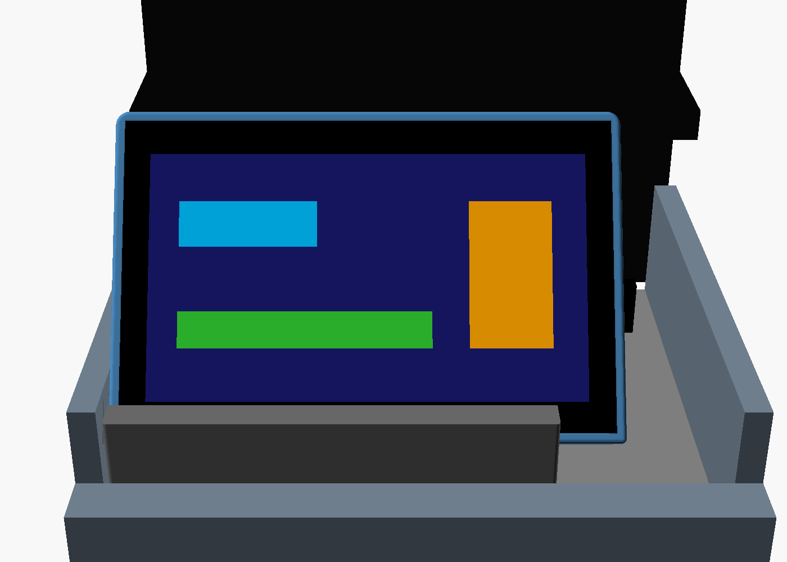
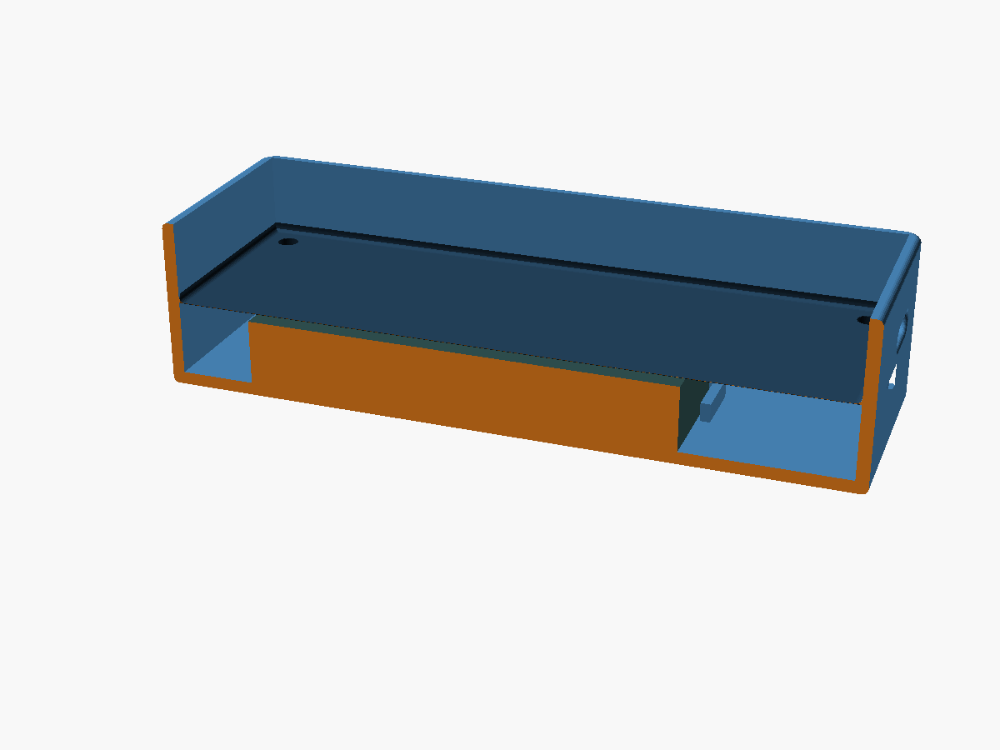
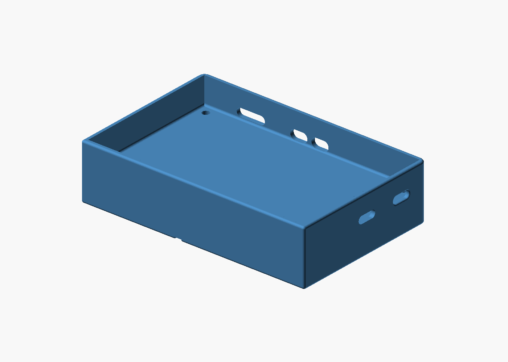
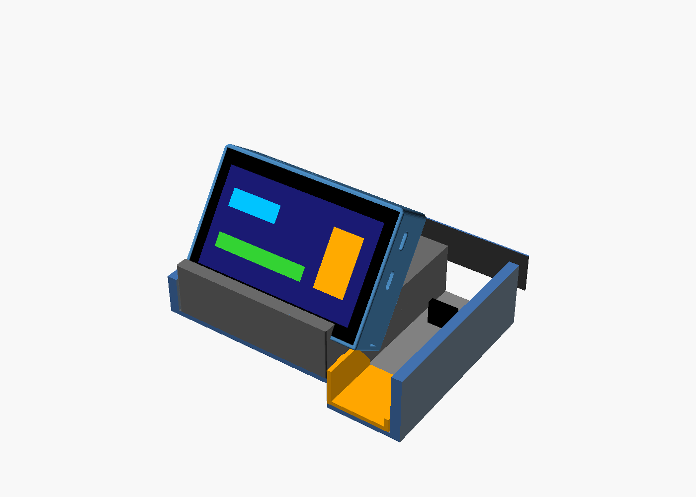
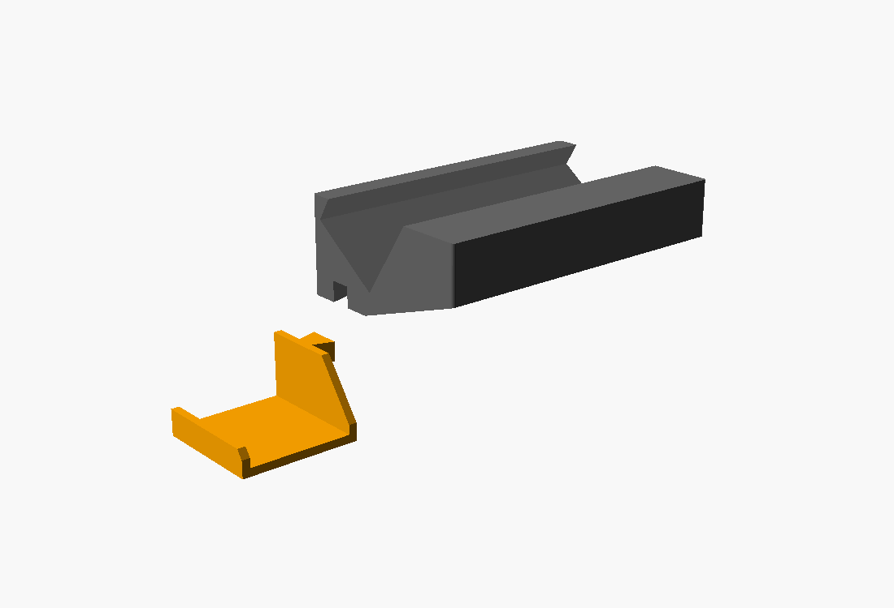
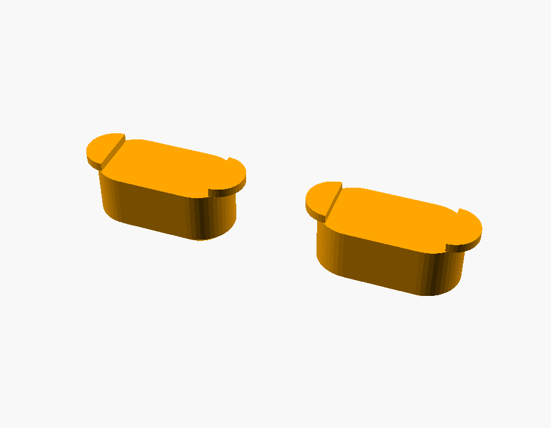
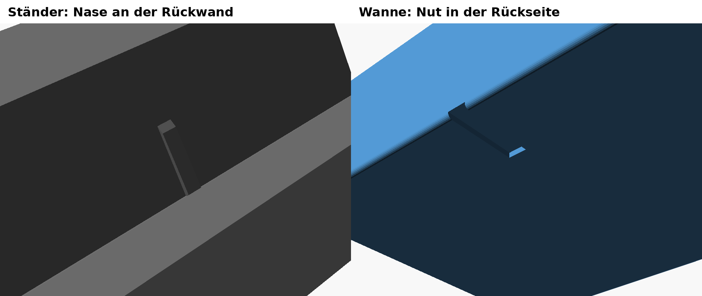

# Gehäuse Waveshare 4.3" mit Akku und Ständer



Stand 24.10.2026: **fertig. Wanne und Ständer mit Nase gedruckt, alles passt**
(Marc). Display im Ständer 35° nach hinten geneigt; USB-C- und Tastenöffnungen
nach dem ersten Probedruck nachgestellt.

| Kurz | |
|---|---|
| Wanne | 111 × 72,6 × 27 mm, Akku unter dem Board, 4 × M2,5 × 16 Zylinderkopf von unten |
| Öffnungen | 2 × USB-C (UART und USB), BOOT und RESET oben, Nut für die Nase hinten |
| Ständer | Klemm-Einsatz 96 × 61 × 30 mm für die linke Fläche der Ablage vor den Getränkehaltern, Schlitz 35° |
| Flügel | U-Profil in der USB-Mulde, in den Ständer gesteckt, gegen Rutschen nach rechts |
| Nase | Rippe im Ständer-Schlitz greift in die Nut der Wanne, gegen seitliches Rutschen |
| Akku | Meshnology 103665, 3,7 V 3000 mAh, PH2.0 |
| Material | PETG oder ASA |

## Drucken

| Teil | Datei | Lage beim Druck |
|---|---|---|
| Gehäusewanne mit Akkufach | `stl/ws43_tray_akku.stl` | Boden nach unten, ohne Support |
| Ständer für die Ablage | `stl/ws43_staender_akku.stl` | auf der linken Seitenfläche, ohne Support |
| Flügel für die USB-Mulde | `stl/ws43_fluegel_mulde.stl` | Boden nach unten, ohne Support |
| Tastenkappen mit Kragen (2 Stück, von innen einsetzen) | `stl/ws43_tastenkappen_kragen.stl` | Außenseite nach unten, ohne Support |

PETG oder ASA (Hitze im Auto), nicht PLA. Dazu 4 × M2,5 × 16 Zylinderkopf (ISO 4762, Kopf versenkt in 5,0 × 2,7 mm; M3 passt nicht ins Board, M2,5 am 29.10. bestaetigt) und ein
dünnes Schaumstoffpad auf den Akku.

## Gehäusewanne



Grundlage ist Marcs Wanne `stl/ws43_tray_original.stl` (111 × 72,6 × 15 mm
außen, Board-Löcher 98 × 60 mm, USB-Ausschnitt rechts). `ws43_tray_akku.stl`
ist dieselbe Wanne, 12 mm tiefer (27 mm). Sie ist aus dem Original
zusammengesetzt (Boden mit Kantenrundung, Wandprofil verlängert,
oberer Teil angehoben), damit Kanten und Radien gleich bleiben.

Zusätzlich zur USB-C-Öffnung des Originals (UART) hat die Wanne eine zweite
für die USB-Buchse und an der oberen Kante Öffnungen für BOOT, RESET und die
microSD-Karte (SD seit 24.10., am 25.10. gedruckt, passt)
(`side_openings()` in der `.scad`, Positionen aus Marcs Messung und Foto vom
23.10., nach dem Probedruck am 24.10. um ca. 1 mm nachgestellt).



Der Akku liegt auf dem Boden zwischen vier Winkeln. Das Board liegt darüber
auf vier hohen Schraubbolzen in derselben Höhe wie vorher auf dem Boden.
Montage: Akku einlegen, Pad drauf, Board einsetzen, die vier Schrauben von
unten durch die Bolzen in die Board-Abstandsbolzen. Zum Akkuwechsel muss das
Board raus.

## Akku

Meshnology **103665**, 3,7 V 3000 mAh, PH2.0-Stecker, mit Schutzschaltung
(Amazon B0FJ1GX4P6). Nennmaß 10 × 36 × 65 mm, im Modell 10,5 × 37 × 69 mm
(Schutzplatine am Kabelende, Toleranz). **Vor dem Einstecken Polarität
prüfen:** bei PH2.0-Akkus von Amazon ist Rot/Schwarz oft andersherum als am
Board-Stecker. Anderer Akku: `batt_l`, `batt_w`, `batt_t` (ggf. `batt_x/y`)
oben in `ws43_akkufach.scad` ändern; flache Akkus bis ca. 88 × 60 × 10 mm passen.

## Ständer



Klemm-Einsatz für die linke Fläche der Ablage vor den Getränkehaltern,
96 × 61 × 30 mm, dazu rechts der gesteckte Flügel. Er sitzt zwischen linker Seitenwand und USB-Nische
(ggf. Filzband an die Seiten), vorne an der Kante zu den Getränkehaltern.
Die Unterseite folgt dem Boden: vorne 23 mm eben, dahinter die flache Rampe
(15 mm Anstieg auf ca. 45 mm, aus Fotos geschätzt, `st_ramp`).

Schlitz 27,4 mm, 35° nach hinten geneigt (Marcs Original hatte 20°, am
23.10. auf 35° flacher gestellt, `st_tilt`), beidseitig offen. Die niedrige Seite mit
der Vorderlippe (7 mm, `st_lip`; der Schlitzboden wird daraus berechnet) zeigt zu den Getränkehaltern, das Display schaut zum
Fahrer. Bündig links ragt das Gehäuse ca. 15 mm über die USB-Nische; die
USB-Buchse des Displays liegt rechts, auf der Seite der USB-Buchse des Autos.

### Flügel in die USB-Mulde



Seit 26.10. gibt es einen eigenen Flügel (`stl/ws43_fluegel_mulde.stl`): ein
dünnes U-Profil (2,5 mm Wand, `wing_wall`), das quer über die USB-Mulde bis an
deren rechte Wand reicht (37 mm, 1 mm Luft, `wing_w`) und auf dem Muldenboden
liegt. Der rechte Schenkel (8 mm, `wing_right`) liegt an der Muldenwand, der
linke an der Stufe. So stützt sich der Ständer rechts ab und rutscht nicht
mehr; nach links hält ihn die Seitenwand. Die Mulde liegt 16 mm tiefer als
die linke Fläche (`wing_drop`, von Marc am 27.10. gemessen). Hinter der
ebenen Fläche fallen die Schenkel bis 35 mm Tiefe auf 4 mm über dem
Muldenboden ab (`wing_d`, `wing_top_end`), damit USB-Gehäuse und Stecker frei
bleiben.

Verbindung: Vorne trägt der linke Schenkel einen 6 mm hohen
Schwalbenschwanz-Zapfen (`dt_*`), der auf der ebenen Fläche liegt. Der Ständer
hat dafür unten rechts eine Nut (0,25 mm Spiel je Seite, `dt_fit`). Erst den
Flügel in die Mulde legen, dann den Ständer von oben aufsetzen. Beide Teile
drucken ohne Support. Am 28.10. gedruckt, passt perfekt in die Mulde (Marc).

### Tastenkappen für BOOT und RESET



Passen ohne Änderung an der Wanne in die Tastenöffnungen. Eine erste Version
mit Kopf außen (26.10., Länge 2,6 mm passte) fiel bei schräg stehendem Gehäuse
heraus und ist entfallen.

Diese Kappen werden von innen eingesetzt, bevor das Board eingeschraubt wird,
und können dann nicht mehr herausfallen. Sie haben keinen Kopf: Der Stift ragt
außen 1,5 mm heraus (`kcap_out`). Hinter der Wand sitzt ein 0,5 mm starker
Kragen nur an den Enden, neben dem 6 mm breiten Taster (`kcap_collar`,
`kcap_free`). In der Mitte drückt der Stößel auf den Taster. Probedruck 27.10. (Varianten 0 / 0,2 / 0,4 mm
Stößel hinter der Wand-Innenseite): 0 passt, das ist jetzt die einzige
Variante in `stl/ws43_tastenkappen_kragen.stl` (zwei Kappen, `kcap_tips`).


### Nase gegen Rutschen



Eine 3 mm breite Rippe an der hinteren Schlitzwand (1 mm hoch, 14 mm lang ab
Schlitzboden, oben angeschrägt) greift in eine unten offene Nut in der
Wannenrückseite (3,8 mm breit, 1,1 mm tief). Das Gehäuse wird von oben
eingesetzt und kann dann nicht mehr seitlich rutschen; es sitzt bündig mit der
linken Ständerkante (`nose_X`, `groove_x`). Seit 24.10. (PR #20), gedruckt und passt.

### Maße der Ablage (Marc, 23.10.)

| | |
|---|---|
| Gesamtbreite innen | 135 mm |
| linke Fläche | 97 mm |
| USB-Nische | 45 mm (oben gemessen) |
| Tiefe bis unters Klimabedienteil | 115 mm |
| Seitenwände | 33 mm |
| Kante zu den Getränkehaltern | 15 mm |
| ebener Boden ab dieser Kante | 23 mm |
| Anstieg danach | 15 mm |
| Platz unter dem Klimabedienteil | 55 mm |

`ablage_modell.scad` baut die Ablage daraus nach (nur für die Vorschaubilder). Geschätzt sind die Rampenlänge, die Höhe
der Trennkante zur USB-Nische und der Überstand des Klimabedienteils.

## Neu exportieren

```
openscad -D 'part="tray_gross"' -o stl/ws43_tray_akku.stl ws43_akkufach.scad
openscad -D 'part="staender"'   -o stl/ws43_staender_akku.stl ws43_akkufach.scad
```

Vorschaubilder: `part="cutaway"` (preview.png), `part="stand_preview"`
(preview_staender.png), `ablage_modell.scad` (ablage_display_*.png).
`stl/ws43_tray_original.stl` ist Marcs Originalwanne; die `.scad` baut die
tiefere Wanne daraus, deshalb muss sie liegen bleiben.

LiPo nur mit Schutzschaltung verwenden und im Sommer nicht in der prallen
Sonne liegen lassen.
